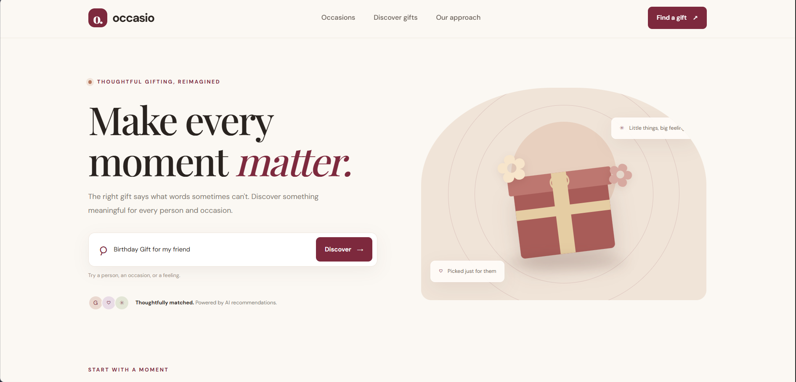
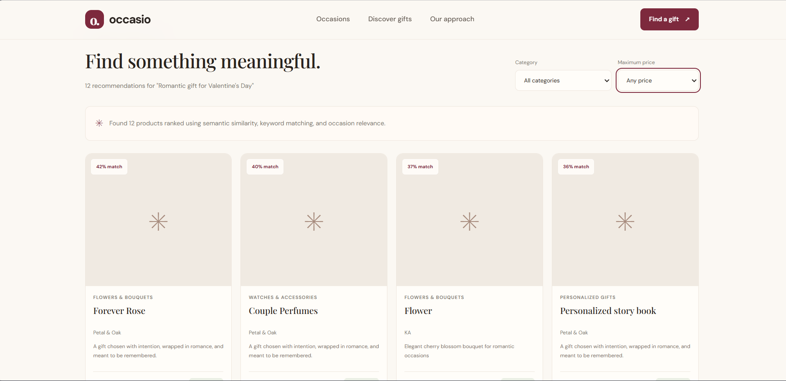

# Occasio — Occasion-Based Product Recommendation System

## 1. Introduction

Occasio is an occasion-based product recommendation system that helps users find suitable gifts and products for different occasions, such as birthdays, weddings, Diwali, Valentine's Day, anniversaries, and office parties.

The main idea behind this project is to make product discovery easier. Instead of manually searching through a large product catalog, users can enter what they are looking for in natural language, and the system recommends relevant products in ranked order.

For example, a user can search for:

- Diwali gifts and festive hampers
- A birthday gift for a friend
- A thoughtful wedding gift
- Gifts for an office party

The system analyzes the search query, compares it with the available product information, and returns products based on their relevance to the user's requirements.

I developed this project to explore how Natural Language Processing (NLP), semantic similarity, and recommendation techniques can be combined to create a practical product discovery experience.

## 2. Problem Statement

Online shopping platforms can contain hundreds or thousands of products. Finding the right product for a particular occasion can take time, especially when users do not know the exact product name or category.

Traditional keyword-based search may fail when the user's query and the product description use different words but have similar meanings.

For example, a user searching for "a thoughtful present for a friend" may be interested in products described as gift hampers, personalized gifts, or gift boxes.

The objective of this project is to build a recommendation system that understands the user's search intent more effectively, ranks relevant products, and supports useful filters such as product category and price range.

## 3. Project Objectives

The main objectives of this project are:

- Build an occasion-based product recommendation system.
- Process a supplied product catalog and normalize its data.
- Use semantic similarity to understand the meaning of search queries.
- Combine semantic search with traditional text matching.
- Improve ranking for products explicitly associated with the requested occasion.
- Provide a simple and responsive user interface.
- Develop API endpoints for recommendations and product categories.
- Validate the implementation using automated tests.
- Maintain clean, understandable, and documented code.

## 4. Technologies Used

| Technology | Purpose |
|---|---|
| Python | Core programming language |
| Flask | Backend API development |
| Sentence Transformers | Generate semantic text embeddings |
| all-MiniLM-L6-v2 | Pre-trained sentence embedding model |
| Scikit-learn | TF-IDF vectorization and cosine similarity |
| NumPy | Numerical operations |
| HTML | Frontend structure |
| CSS | Styling and responsive layout |
| JavaScript | Frontend interactions and API requests |
| Tailwind CSS CDN | Utility-based frontend styling |
| Pytest | Automated testing |
| Git and GitHub | Version control and project hosting |

The project uses a pre-trained embedding model and does not require a paid AI API.

## UI Screenshots

### 1. Occasion Search Input


### 2. Product Recommendations


## 5. How the Recommendation System Works

The recommendation engine uses a hybrid approach that combines semantic similarity, keyword-based similarity, and occasion-specific relevance.

### Step 1: Load and normalize the product catalog

The supplied JSON product catalog is loaded and converted into a consistent internal format.

The source catalog uses fields such as `id`, `shopId`, `categoryId`, `name`, `description`, and `mainImage`.

The data loader maps these source fields into the format required by the application. It also retains the assignment's standard fields wherever they are available.

The catalog filtering process excludes products that do not have a title, are not active, are not approved, have been deleted, or have no available stock.

In the current dataset, **110 source products were supplied, and 104 products remained eligible after filtering**.

The original JSON file is not modified during normalization.

### Step 2: Generate semantic embeddings

The system uses the pre-trained `sentence-transformers/all-MiniLM-L6-v2` model to convert product text into numerical vector representations called embeddings.

These embeddings help the system compare the meaning of the user's query with product information rather than depending only on exact word matches.

For example, the terms "present" and "gift" may be related in meaning even when the words are different.

### Step 3: Calculate semantic similarity

The user's query is converted into an embedding and compared with the product embeddings using cosine similarity.

Products with greater semantic similarity receive stronger semantic relevance scores.

### Step 4: Calculate TF-IDF similarity

The system also uses TF-IDF (Term Frequency–Inverse Document Frequency) to identify useful word matches between the query and product text.

Cosine similarity is applied to the TF-IDF vectors to calculate lexical relevance.

This helps the system recognize exact and closely related terms that might be important to the user's search.

### Step 5: Combine both approaches

The semantic and TF-IDF scores are combined into a hybrid relevance score.

The current weights are:

- Semantic similarity: **65%**
- TF-IDF similarity: **35%**

This combination balances understanding the meaning of a query with matching relevant words in the product catalog.

### Step 6: Apply occasion-based ranking

The system recognizes supported occasions, including birthdays, weddings, Diwali, Valentine's Day, anniversaries, Mother's Day, Father's Day, Raksha Bandhan, Christmas, housewarmings, farewells, graduations, office parties, thank-you gifts, and baby showers.

When a product title explicitly mentions the requested occasion, it receives an additional ranking bonus. Relevant occasion-related terms in the product text can also contribute to the bonus.

These adjustments help occasion-specific products appear higher in the results without completely replacing semantic and lexical relevance.

### Step 7: Apply filters and return ranked products

Users can request a limited number of results and apply available filters such as category, minimum price, and maximum price.

The system ranks the eligible products and returns the results with relevance information, matched terms, recognized occasions, and recommendation reasons where available.

**Important:** The returned score is a ranking signal, not a calibrated probability that a user will purchase or prefer a product.

## 6. System Architecture

The project is divided into a frontend, a backend API, a data-loading module, and a recommendation engine.

1. **Frontend:** Accepts the user's search query and displays recommendation results.
2. **Flask API:** Receives requests, validates parameters, and returns JSON responses.
3. **Data loader:** Reads, normalizes, and filters the product catalog.
4. **Recommendation engine:** Generates embeddings, calculates similarity scores, applies occasion-aware ranking, and returns ranked results.
5. **Product catalog:** Stores the supplied product data in JSON format.

The frontend communicates with the backend through HTTP requests. The backend processes the query and sends the recommendation results back to the frontend.

## 7. Project Structure

```text
occasion-recommender/
│
├── backend/
│   ├── app.py
│   ├── data_loader.py
│   ├── recommender.py
│   ├── requirements.txt
│   └── data/
│       └── products.json
│
├── frontend/
│   ├── index.html
│   ├── css/
│   │   └── style.css
│   └── js/
│       └── app.js
│
├── tests/
│   ├── test_data_loader.py
│   ├── test_recommender.py
│   └── test_api.py
│
├── README.md
└── .gitignore
```

### Main files

- `backend/app.py`: Defines the Flask application and API endpoints.
- `backend/data_loader.py`: Normalizes the product data and applies eligibility filters.
- `backend/recommender.py`: Implements the hybrid recommendation algorithm.
- `backend/data/products.json`: Contains the supplied product catalog.
- `frontend/index.html`: Defines the frontend page.
- `frontend/css/style.css`: Contains custom styling.
- `frontend/js/app.js`: Handles search interactions and communication with the backend.
- `tests/test_data_loader.py`: Tests product field mapping and data normalization.
- `tests/test_recommender.py`: Tests recommendation ranking, score validity, and price filtering.
- `tests/test_api.py`: Tests API endpoints and invalid requests.

## 8. Product Data Mapping

The assessment specifies the following standard product fields:

| Standard field | Mapping or handling |
|---|---|
| `product_id` / `productId` | Uses the available identifier, including the source `id` field |
| `vendor_id` / `vendorId` | Uses the available vendor identifier, including source `shopId` |
| `vendor_category` | Preserved when supplied |
| `vendor_category_desc` | Preserved when supplied |
| `title` | Uses the source `title` or `name` |
| `description` | Uses the source description, with short description as a fallback |
| `files` | Preserved when supplied; `mainImage` can be adapted into a file entry |

The provided catalog does not contain all the assignment's standard fields. In particular, `vendor_category` and `vendor_category_desc` are not available in the source structure we inspected.

I have kept those fields as unavailable when the source does not provide them instead of generating potentially incorrect values. The source `categoryId` is retained separately and is not treated as a category description.

This approach preserves the original data while allowing the application to work with a consistent product schema.

## 9. Installation and Setup

The following instructions are for Windows Command Prompt (CMD).

### Prerequisites

- Python 3.12 or a compatible Python version
- pip
- Git, if you want to clone the repository
- A modern web browser

### Step 1: Open the project folder

Open CMD and navigate to the project directory:

```cmd
cd /d C:\Users\sriva\OneDrive\Desktop\occasion-recommender
```

If you have downloaded or cloned the project somewhere else, use that directory instead.

### Step 2: Create a virtual environment

```cmd
python -m venv .venv
```

Activate it:

```cmd
.venv\Scripts\activate
```

### Step 3: Install dependencies

```cmd
python -m pip install --upgrade pip
python -m pip install -r backend\requirements.txt
```

The first run may take longer because the sentence embedding model needs to be downloaded. An internet connection is required for the initial model download unless the model is already cached locally.

### Step 4: Start the backend

From the project root, run:

```cmd
python -m backend.app
```

The Flask API will be available at:

```text
http://127.0.0.1:5000
```

Keep this terminal running.

### Step 5: Start the frontend

Open a second CMD terminal and navigate to the project root:

```cmd
cd /d C:\Users\sriva\OneDrive\Desktop\occasion-recommender
```

Activate the environment if necessary:

```cmd
.venv\Scripts\activate
```

Start the frontend's local HTTP server:

```cmd
python -m http.server 8000 --directory frontend
```

Open the application in your browser:

```text
http://127.0.0.1:8000/
```

Keep both terminals running while using the application.

## 10. API Documentation

The backend provides the following endpoints.

### Home endpoint

**Request**

```http
GET /
```

Returns the API status, eligible product count, and available endpoint information.

### Health endpoint

**Request**

```http
GET /api/health
```

Checks whether the API is running and returns information about the eligible product count and embedding model.

### Categories endpoint

**Request**

```http
GET /api/categories
```

Returns the categories available in the normalized product catalog.

### Recommendation endpoint

**Request**

```http
GET /api/recommend?q=Diwali%20gifts&limit=5
```

Returns ranked product recommendations for the supplied query.

Supported query parameters:

| Parameter | Purpose |
|---|---|
| `q` | Search query; required |
| `limit` | Maximum number of results requested |
| `category` | Filter results by category |
| `min_price` | Minimum product price |
| `max_price` | Maximum product price |

For example:

```http
GET /api/recommend?q=birthday%20gift&max_price=1000
```

This requests birthday gift recommendations priced at or below 1000 in the catalog's price units.

The API returns the query, result count, and matching products in JSON format. Requests with a missing query or invalid price values return an appropriate error response.

## 11. Testing and Validation

I used Pytest to validate the data loader, recommendation engine, and Flask API.

The current test suite contains **23 automated tests, and all 23 passed**.

| Test module | Tests | Result |
|---|---:|---|
| `test_api.py` | 8 | All passed |
| `test_data_loader.py` | 7 | All passed |
| `test_recommender.py` | 8 | All passed |
| **Total** | **23** | **All passed** |

The tests cover:

- Product eligibility and catalog normalization
- Required field mapping and source-field aliases
- Preservation of unavailable vendor fields
- Product image adaptation from `mainImage`
- Ensuring normalization does not mutate the source object
- Recommendation result counts
- Occasion-based ranking
- Empty search queries
- Price filtering and invalid price ranges
- Recommendation score validity
- API health and category endpoints
- Missing queries and invalid API parameters

To run the complete test suite, use:

```cmd
python -m pytest tests -v
```

The latest complete test run finished with **23 passed in 24.02 seconds**.

## 12. Challenges and Learnings

One challenge was handling differences between the product catalog's original schema and the fields required by the assessment.

I addressed this by building a normalization layer that maps available fields into a consistent format while preserving missing information rather than fabricating it.

Another important learning was that keyword matching alone is not enough for flexible product discovery. Combining semantic embeddings with TF-IDF provides a more balanced approach to understanding natural-language queries and matching product text.

I also learned the importance of validating the recommendation logic and API behavior through automated tests instead of relying only on manual browser checks.

Finally, this project helped me understand how to connect an NLP-based recommendation engine with a backend API and a user-facing interface.

## 13. Current Limitations and Future Improvements

The current implementation is a working prototype, and there are several areas where it can be improved.

- **Product images:** Image display still needs additional debugging and validation.
- **Catalog metadata:** The source dataset does not supply every standard assignment field.
- **Ranking evaluation:** The current relevance scores have not been calibrated against real user preferences or purchase outcomes.
- **Recommendation evaluation:** Future work could include a labeled evaluation dataset and ranking metrics such as Precision@K and NDCG@K.
- **Category quality:** Automatically inferred display categories could be improved with better catalog metadata.
- **Personalization:** Future versions could incorporate user preferences and past interactions.
- **Deployment:** The application can be deployed to a public hosting platform for easier access.
- **Performance:** Model loading and recommendation latency could be measured and optimized as the catalog grows.

These are future improvements, not features that I am claiming are already implemented.

## 14. Responsible Use of AI Assistance

I used ChatGPT (GPT-6) as a learning and development assistant while working on this project.

It helped me understand the assessment requirements, explore the recommendation approach, work through implementation steps, review data mapping, prepare automated tests, troubleshoot issues, and organize the documentation.

I used this assistance to improve my understanding of the implementation and development process. The project-specific decisions, local execution, testing, and verification were carried out as part of my own development workflow.

I am documenting the assistance transparently rather than claiming that every part of the work was created independently without AI support.

## 15. Conclusion

Occasio demonstrates how semantic embeddings, TF-IDF similarity, and occasion-aware ranking can be combined to build a practical product recommendation system.

The application processes a supplied product catalog, accepts natural-language search queries, ranks relevant products, provides API-based access to recommendations, and supports price and category filters.

With 104 eligible products and 23 passing automated tests in the current implementation, the project provides a tested foundation for further improvements in recommendation quality, image handling, personalization, and deployment.

The main learning outcome for me was understanding how NLP techniques can be integrated into a complete application rather than being used only as an isolated model.

---

**Project:** Occasio — Occasion-Based Product Recommendation System

**Primary language:** Python

**Recommendation approach:** Hybrid semantic and TF-IDF ranking

**Status:** Local prototype implemented; automated test suite passing
